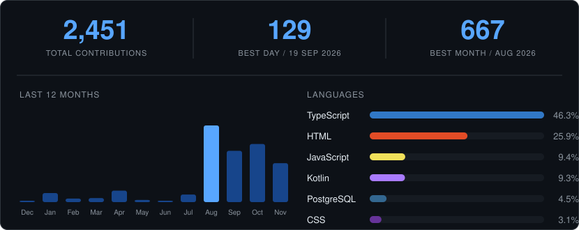

  I build full-stack web apps, Android apps and PWAs, and I go deep on systems work in C++. 
  Currently working on point-of-sale and hotel management software, campus tools and learning platforms. 
  I solve and document data structures and algorithms problems every day.

 

### In production with

I built **counterX** from scratch: the offline-first platform that runs the tills, front desks and rent rolls of hotels, restaurants and residential complexes across Pakistan. It keeps selling when the internet doesn't.

| Client | Business | Product |
|:--|:--|:--|
| Riviera Resort | 4-star hotel, Naran. 90 rooms, 50+ apartments | Hotel Manager |
| Riviera Diner | Resort restaurant, 2 locations, 30 tables | POS |
| Umair Residencia | E-11, Islamabad. 120 apartments | Property Manager |
| MK ROS Heights | Multi-residence complex. 60+ flats and shops | Property Manager |
| Glimermint | 350K+ followers | Business Manager and website |
| Little Orbit | Fast food, 4 branches | POS |

 

### Stack

 

### Selected work

| Project | What it is | Commits |
|:--|:--|--:|
| **counterX** | Point of sale, hotel and property management platform, running in production | 1,300+ |
| [**Accounting-riviera**](https://github.com/abdulwalidev/Accounting-riviera) | Accounting system built for Riviera | 620+ |
| [**spdump**](https://github.com/abdulwalidev/spdump) | Web app and supporting files | 95+ |
| [**algovista**](https://github.com/abdulwalidev/algovista) | Visual algorithm learning platform with interactive step-by-step animations | 70+ |
| [**DSA__progress**](https://github.com/abdulwalidev/DSA__progress) | Public LeetCode log following the NeetCode roadmap | 60+ |

 

### Activity

