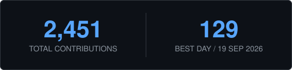

  

  I build full-stack web apps, Android apps and PWAs, and I go deep on systems work in C++. 
  Currently working on point-of-sale and hotel management software, campus tools and learning platforms. 
  I solve and document data structures and algorithms problems every day.

 

### Stack

  
  
  
  
  
  
  
  
  

 

### Selected work

<table>
  <tr>
    <td width="50%" valign="top">
      <a href="https://github.com/abdulwalidev/algovista"><b>algovista</b></a> 
      Visual algorithm learning platform. Interactive animations, multi-language examples, step-by-step execution.
    </td>
    <td width="50%" valign="top">
      <a href="https://github.com/abdulwalidev/Lawlingo"><b>Lawlingo</b></a> 
      Study platform that turns heavy law theory into practice for university students.
    </td>
  </tr>
  <tr>
    <td valign="top">
      <a href="https://github.com/abdulwalidev/Chess"><b>Chess</b></a> 
      Full chess engine in C++, built as a CLI first, then given a GUI.
    </td>
    <td valign="top">
      <a href="https://github.com/abdulwalidev/Compressor-Decompressor"><b>Compressor-Decompressor</b></a> 
      File compression and decompression in C++.
    </td>
  </tr>
  <tr>
    <td valign="top">
      <a href="https://github.com/abdulwalidev/pharmacy_app_supabase"><b>pharmacy_app_supabase</b></a> 
      Pharmacy management system: SQL schema, Node and Express API, browser UI.
    </td>
    <td valign="top">
      <a href="https://github.com/abdulwalidev/DSA__progress"><b>DSA__progress</b></a> 
      Public log of my LeetCode journey following the NeetCode roadmap.
    </td>
  </tr>
</table>

 

### In production with

I build and run <b>counterX</b>, a point of sale, hotel, property and business management platform that works offline. It is live with:

<table>
  <tr>
    <td width="33%" valign="top"><b>Riviera Resort</b> 4-star hotel, Naran 90 rooms, 50+ apartments &middot; Hotel Manager</td>
    <td width="33%" valign="top"><b>Riviera Diner</b> Resort restaurant, 2 locations 30+ staff, 30 tables &middot; POS</td>
    <td width="33%" valign="top"><b>Umair Residencia</b> E-11, Islamabad 120 apartments &middot; Property Manager</td>
  </tr>
  <tr>
    <td valign="top"><b>MK ROS Heights</b> Multi-residence complex 60+ flats and shops &middot; Property Manager</td>
    <td valign="top"><b>Glimermint</b> 350K+ followers Business Manager and website</td>
    <td valign="top"><b>Little Orbit</b> Fast food Dine-in, takeaway, delivery &middot; POS</td>
  </tr>
</table>

 

### Activity

  
  

  

